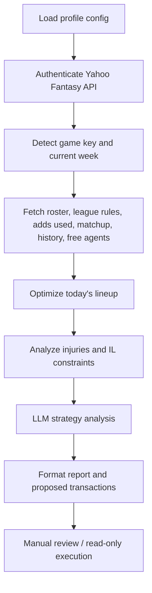

# Project Business Logic

## Executive Summary

This project is an agentic Yahoo Fantasy NBA roster assistant. It gathers Yahoo Fantasy league, team, matchup, roster, injury, schedule, historical, and waiver-wire data; analyzes current-week competitive gaps; and produces explainable roster, IL, streaming, and add/drop recommendations for a fantasy basketball manager.

The current system is intentionally recommendation-first. It can build transaction payloads and contains execution helpers, but the main flow prints suggested actions and requires manual review before any real Yahoo roster transaction.

## Business Problem

Fantasy basketball roster decisions are time-sensitive and data-heavy. A manager needs to answer questions like:

- Which categories are safe, competitive, or effectively lost this week?
- Which injured players should move to IL or IL+?
- Which healthy players are stuck in IL and need activation?
- Which bench players should start today?
- Which free agents are worth streaming today based on games, category needs, health, rank, and ownership?
- Which players are safe to drop without damaging long-term team value?

The project reduces manual research by combining Yahoo Fantasy state, NBA schedule context, roster constraints, and LLM reasoning into one repeatable decision workflow.

## Target User

The primary user is a competitive Yahoo Fantasy Basketball manager in either:

- `9cat` head-to-head category leagues.
- `points` head-to-head points leagues.

The configured default profile is a Yahoo NBA league/team profile, with support for multiple profiles through `config.json`.

## Core Business Capabilities

### 1. League and Team Context Detection

The app discovers the active Yahoo game key and current fantasy week, then builds Yahoo league and team keys used across API calls.

Business value:

- Keeps the workflow aligned to the current fantasy season.
- Reduces hard-coded season maintenance.
- Supports profile-based league/team switching.

### 2. Roster Intelligence

The system fetches the current roster, selected positions, eligibility, editability, health status, ranks, team abbreviations, season stats, and whether each player has a game today.

Business value:

- Identifies start/bench/IL opportunities.
- Protects high-value players from short-term streaming churn.
- Makes roster recommendations specific to the current lineup, not generic rankings.

### 3. Injury and IL Management

The app separates players into active roster, bench, IL, and IL+ buckets, then detects:

- Injured or out players occupying active roster spots.
- Healthy players stuck in IL slots.
- Full standard roster situations.
- Full IL/IL+ capacity situations.

Business value:

- Prevents lost games from inactive players sitting in scoring slots.
- Surfaces activation/drop trade-offs when roster capacity is constrained.
- Preserves long-term value by preferring IL moves over drops.

### 4. Daily Lineup Optimization

The current root workflow includes a greedy position optimizer that attempts to start healthy, editable players with games today. It fills specialized positions first, then semi-flex positions, then utility slots.

Business value:

- Maximizes active games played.
- Avoids wasting scoring opportunities on the bench.
- Produces explicit start/bench instructions for manual execution.

### 5. Matchup and Historical Category Analysis

The app fetches live matchup stats and previous completed weeks for both the user and current opponent. It calculates historical averages and live category gaps across 9-category stats:

- FG%
- FT%
- 3PTM
- PTS
- REB
- AST
- STL
- BLK
- TO

Business value:

- Distinguishes short-term noise from repeatable strengths and weaknesses.
- Helps choose between category streaming, conservative holds, and targeted add/drop actions.
- Supports matchup-specific strategy instead of season-long generic optimization.

### 6. Waiver-Wire and Streaming Search

The app queries Yahoo free agents, merges multiple sorted views, filters injured or waiver players, and narrows candidates by schedule availability. It enriches candidates with ownership, rank, team, season averages, and category profile.

Business value:

- Finds actionable players who can help immediately.
- Prioritizes quality candidates by ownership/rank while still considering category specialists.
- Supports daily streaming within weekly add limits.

### 7. LLM Strategy Reasoning

The root workflow sends structured roster, matchup, historical, injury, roster-rule, and waiver context to an LLM through OpenRouter using a Gemini model. The prompt asks for:

- Matchup win plan.
- Injury status and return timeline discussion.
- Category or points risk analysis.
- Player role classification.
- This-week value ranking.
- Drop priority list.
- Streaming rules.
- Structured automation JSON.

Business value:

- Converts raw tables into human-readable strategic recommendations.
- Forces explicit reasoning around categories, constraints, and value preservation.
- Produces machine-readable transaction suggestions for future automation.

### 8. Human-Gated Transaction Safety

The current main workflow prints suggested transactions but does not automatically execute them. Yahoo transaction helper functions exist for roster updates and add/drop XML payloads, but execution is commented out or gated.

Business value:

- Reduces risk of accidental irreversible roster moves.
- Keeps the manager in control.
- Provides a path toward future approval-based automation.

## Decision Workflow

## Business Rules Encoded in the Current Prompt

- Reason only from the supplied data snapshot; never invent players, ranks, ids, or injury news.
- Preserve high-value players; do not drop elite or high-rank players for streamers.
- Classify roster players into roles: Core Anchor (season rank < 70), Solid Asset (70-130), Streamer/Filler (> 130 or unranked), and Specialist.
- Never recommend dropping a player tagged Core Anchor.
- Follow a fixed decision priority: use open roster spots first, then internal IL swaps, then a forced drop, and only then stream from free agency.
- Prefer moving injured players to IL over dropping healthy assets.
- Do not recommend moving a player to IL if they are already in IL or IL+.
- Treat GTD as uncertain and avoid risky activation unless the player has a game today or is a core asset.
- Respect weekly add limits and treat adds as a scarce resource.
- For `9cat`, label every category Safe / Key / Swing / Lost with its numeric delta, and prioritize flippable (Swing) categories; a 5-4 win counts the same as 9-0.
- For `points`, prioritize total fantasy point production, games remaining, and per-game floor; category balance is irrelevant.
- Emit an empty transaction list when no move is justified, rather than forcing a change.

## Outputs

The current root workflow outputs:

- Console tables for roster, matchup, historical summaries, and free agents.
- Intended lineup movement instructions.
- Injury and IL decision notes.
- LLM-generated matchup strategy.
- Proposed transaction JSON.
- Token usage and estimated LLM cost when available.

## Current Limitations

- The workflow is CLI/console based; there is no web or mobile UI in this repo.
- The repository now contains a single implementation, rooted at `src/main.py`.
- LLM injury return timeline quality depends on available context and model knowledge; the app does not currently browse verified injury news.
- Some execution helpers exist, but automatic transaction execution is intentionally disabled.
- Credentials and tokens are read from environment variables (or an untracked `config.json`) and must be treated as secrets.

